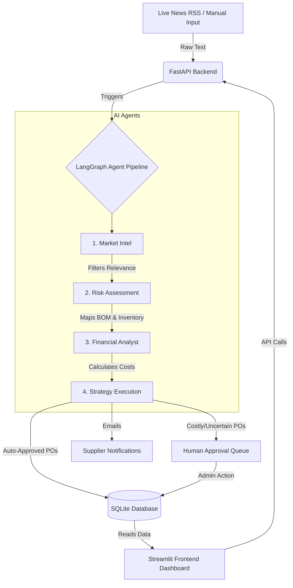

# 🏭 Multi-Agent AI FMCG Supply Chain Disruption Management System

Welcome to the comprehensive overview of the FMCG Supply Chain system. This project is a cutting-edge, autonomous AI pipeline designed to monitor real-world events, map them to a complex supply chain network, and autonomously execute financial and logistical mitigation strategies to prevent factory downtime.

---

## 🏗️ System Architecture

The project is divided into a **FastAPI backend** (powered by LangGraph and SQLAlchemy) and a **Streamlit frontend** dashboard.

---

## 🧠 The AI Agent Pipeline (LangGraph)

The core of the system is a 4-stage sequential state graph. It uses conditional routing to exit early if an event is deemed irrelevant, saving computational resources.

### 1. Market Intel Agent ("The Scout")
- **What it does:** Reads unstructured news articles and extracts a structured JSON threat payload.
- **Key Features:**
  - **Relevance Filter:** Immediately halts the pipeline if the news is not about supply chains (e.g., sports or politics).
  - **Delay Inference Table:** Instead of relying on news articles to guess delays, it maps events (e.g., `flood_regional_severe`, `port_strike`) to a realistic baseline delay matrix.
  - **Confidence Scoring (0-100%):** Evaluates how certain the AI is that this is a real threat.

### 2. Risk Assessment Agent ("The Analyst")
- **What it does:** Cross-references the extracted threat with the company's internal database (Suppliers, Routes, Inventory, Bill of Materials).
- **Key Features:**
  - Identifies exactly which raw materials (e.g., Grade-A Wheat Flour) are sourced from the affected region (e.g., North India).
  - Understands the Bill of Materials (BOM) — knowing that a shortage of wheat halts the entire biscuit production line.

### 3. Financial Analyst Agent ("Smart CFO")
- **What it does:** Performs hard financial math to determine the cost of doing nothing versus the cost of mitigation.
- **Calculations:**
  - Compares **Days of Stock Remaining** vs. **Estimated Delay**.
  - Calculates potential **Factory Idle Cost** (e.g., ₹15,000 per day of downtime).
  - Evaluates **Backup Suppliers** by checking their Minimum Order Quantities (MOQ), maximum capacity, reliability scores, and price premiums.
- **Decisions:** Chooses between `EXECUTE_BACKUP_PO`, `PROACTIVE_ADVISORY`, or `HOLD_AND_MONITOR`.

### 4. Strategy Execution Agent ("The Executor")
- **What it does:** Translates the CFO's decisions into tangible actions.
- **Key Features:**
  - Creates Database entries for Purchase Orders (POs) and Disruption Logs.
  - **Event-Level Deduplication:** Registers the event (e.g., "North Flood") in an `Active Disruptions` table so subsequent news articles about the same flood don't trigger duplicate POs.
  - Generates a concise Executive Summary for the human dashboard.

---

## ⚖️ The Human-in-the-Loop Safeguard

Not all decisions are made autonomously. The system employs strict **guardrails** to protect company finances.

> [!IMPORTANT]
> **The Approval Queue Routing Logic**
> The system will **auto-execute** emergency Purchase Orders UNLESS:
> 1. **Cost Ceiling Violation:** The total cost of the backup PO exceeds `₹100,000`.
> 2. **Low Confidence:** The Market Intel agent gave the threat a confidence score of `< 60%`.
> 
> If either condition is met, the PO is paused and sent to the **Admin Approval Queue** for a human to review.

---

## 🌟 Concrete Examples & Outcomes

Here is how the system reacts to different types of news inputs:

### Example 1: The Severe Regional Flood (Emergency PO)
* **News Input:** "Massive monsoon flooding has destroyed roads in North India, particularly around Delhi and Haryana."
* **Outcome:**
  - **Market Intel:** Extracts `flood_regional_severe` in the `North`, infers a 14-day delay. (Confidence: 95%).
  - **Risk Assessment:** Notices that Primary Supplier A (in Delhi) supplies Wheat. Current wheat stock is only 8 days.
  - **CFO Math:** 14-day delay - 8 days stock = 6 days of factory downtime (Cost: ₹90,000). Backup Supplier B is available in the West region at a ₹2 premium per unit.
  - **Action:** 🔴 **`EXECUTE_BACKUP_PO`**. The system autonomously places an order with Supplier B to cover the gap because the premium is cheaper than the factory downtime cost.

### Example 2: The Minor Road Accident (Buffer Sufficient)
* **News Input:** "A minor collision involving two trucks caused a 4-hour traffic jam on the Mumbai-Pune expressway this morning."
* **Outcome:**
  - **Market Intel:** Extracts `road_accident_minor` in the `West`, infers a 0.3-day delay.
  - **Risk Assessment:** Identifies Sugar coming from Pune. Sugar stock is at 21 days.
  - **CFO Math:** 0.3-day delay is well within the 21-day buffer. Factory downtime risk is ₹0.
  - **Action:** 🟢 **`HOLD_AND_MONITOR`**. No PO is created. The event is simply logged.

### Example 3: The Expensive Alternate (Human Approval Triggered)
* **News Input:** "A massive fire has broken out at a major chemical facility in Gujarat, halting all local exports."
* **Outcome:**
  - **Market Intel:** Extracts `fire_factory` in the `West`, infers a 60-day delay.
  - **Risk Assessment:** Palm Oil supply is cut off. Factory will idle in 15 days.
  - **CFO Math:** Needs a massive backup order from a Southern supplier. The backup PO totals **₹450,000**.
  - **Action:** 🟡 **`PENDING_APPROVAL`**. Because the cost exceeds the ₹100,000 ceiling, the system halts execution. The PO appears in the Admin Dashboard, highlighting the risk math and awaiting a human to click "Approve" or "Reject".

### Example 4: The Duplicate Article (Event Deduplication)
* **News Input:** (3 hours after Example 1) "Updates on the North India floods: Rescue operations underway as roads remain blocked."
* **Outcome:**
  - The API checks the `Active Disruptions` table.
  - It recognizes that a `flood_regional_severe` in the `North` is already being tracked and mitigated.
  - **Action:** 🛡️ **`DEDUP_BLOCKED`**. The pipeline exits immediately, preventing the system from ordering a second, unnecessary batch of wheat.

---

## 🖥️ The Streamlit Frontend Capabilities

The user interacts with the system entirely through the Streamlit dashboard (`frontend/app.py`), which offers:

1. **Disruption Console:** Paste a news article, click run, and watch the AI agents "think" and stream their JSON outputs and rationale live to the screen. Features a **Test Mode** toggle to run simulations without writing real POs.
2. **Admin Approvals:** A dedicated queue where human managers can read the AI's executive briefing and risk math, and click ✅ Approve or ❌ Reject on expensive POs.
3. **Active Disruptions:** Monitor ongoing real-world events that the system is tracking. Click "Resolve" when the flood/strike is over so the system can respond to new events in that region.
4. **Network Map & Inventory:** Live tables showing current stock levels, transport routes, and supplier reliability scores.
5. **Purchase Orders & Logs:** Full historical audit trails of every autonomous action the AI has taken.
